# LingJing V2 综合实训平台

> LingJing 旧版的迭代版本。V2 已从单一的网络安全靶场平台，升级为面向多方向的**综合实训平台**。

## 一、平台简介

LingJing V2 目前已经上线**网络安全**模块。模块内置网络安全渗透测试靶机：购买流量后即可将靶机镜像下载到本地，由**灵境路由**完成配置并实现**秒级启动**，直接在本机开展打靶测试。

## 二、平台安装

| 系统 | 安装教程 |
| --- | --- |
| Windows | [LingJing V2 Windows 安装教程](https://mp.weixin.qq.com/s/kLQWWcS6KgpeUtuGHL1USg) |
| macOS | [LingJing V2 Mac 安装与使用教程](https://mp.weixin.qq.com/s/DCfKQnQXPsu40byCii4m9Q) |

> 安装过程中如遇系统安全拦截，请参阅后文「平台权限说明」一节。

## 三、会员权益

| 权益项 | 说明 |
| --- | --- |
| 下载不限速 | 会员下载不限速；非会员单文件下载限速 10 MB/s |
| 局域网访问靶机 | 会员可将靶机开放给局域网内的其他设备访问（配置方法见 4.1.7） |
| 子靶机操作 | 会员可对靶机及其子靶机进行操作 |

会员是使用**高级功能**的门槛，并不是打靶学习的前置条件：**仅购买流量包即可完成基础打靶**。

## 四、平台使用教程

### 4.1 网络安全

#### 4.1.1 先分清两笔费用：流量包与会员

- **流量包**：用于下载靶机镜像，按下载量扣费。只买流量包、不买会员，同样可以完成基础打靶学习。
- **会员**：高级功能的使用门槛，例如不限速下载、局域网访问靶机、子靶机操作。
- **常见误区**：误以为「必须先买流量、再买会员才能打靶」。实际上，购买流量包后即可开始打靶。

#### 4.1.2 登录账号

点击界面**左下角**的头像区域完成登录。

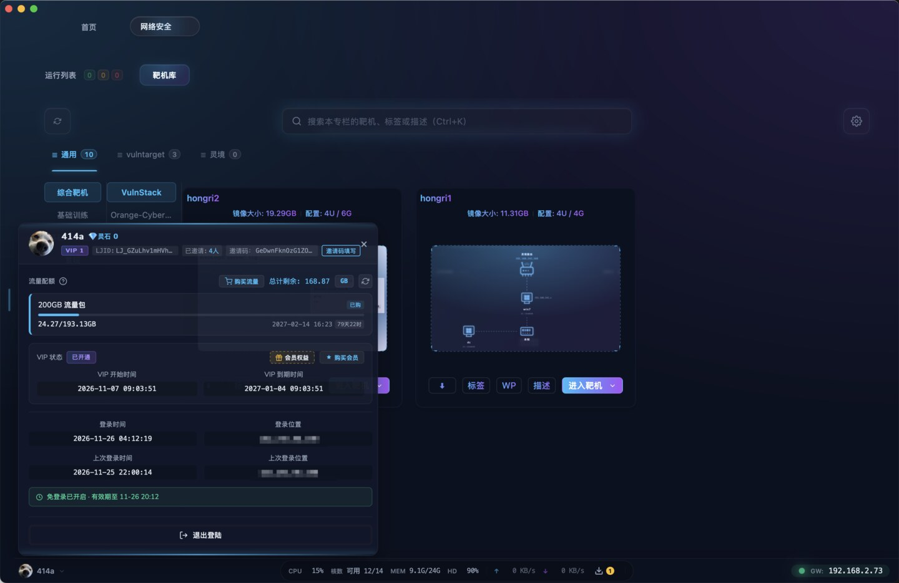

#### 4.1.3 加载靶机库

登录后若「靶机库」中没有任何数据，点击搜索框左侧的**刷新按钮**重新拉取列表。

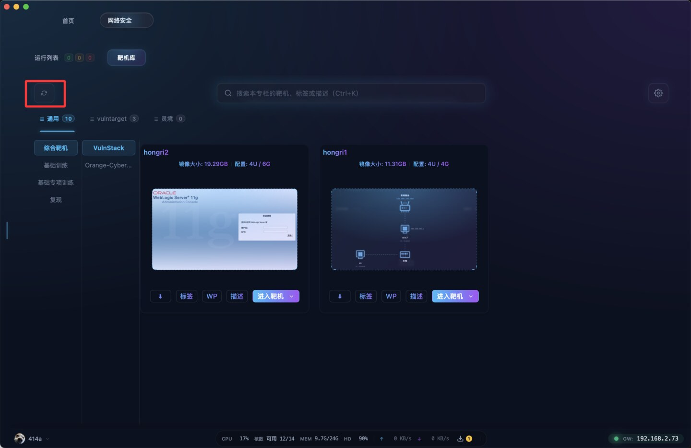

#### 4.1.4 下载靶机

**计费规则**

- 采用**预扣费**模式：点击下载时即一次性扣除该靶机所需的全部流量。
- 停止下载或下载中断时，未下载部分的流量会自动回退。
- 流量包分为**免费流量包**与**付费流量包**，下载时优先使用免费流量包，不足部分再由付费流量包补足。
- 若持有多个付费流量包，单个流量包余量不足时会自动拼凑其他流量包合并扣费。

**购买流量包**：打开左下角个人中心，在「流量配额」中点击**购买流量**即可。

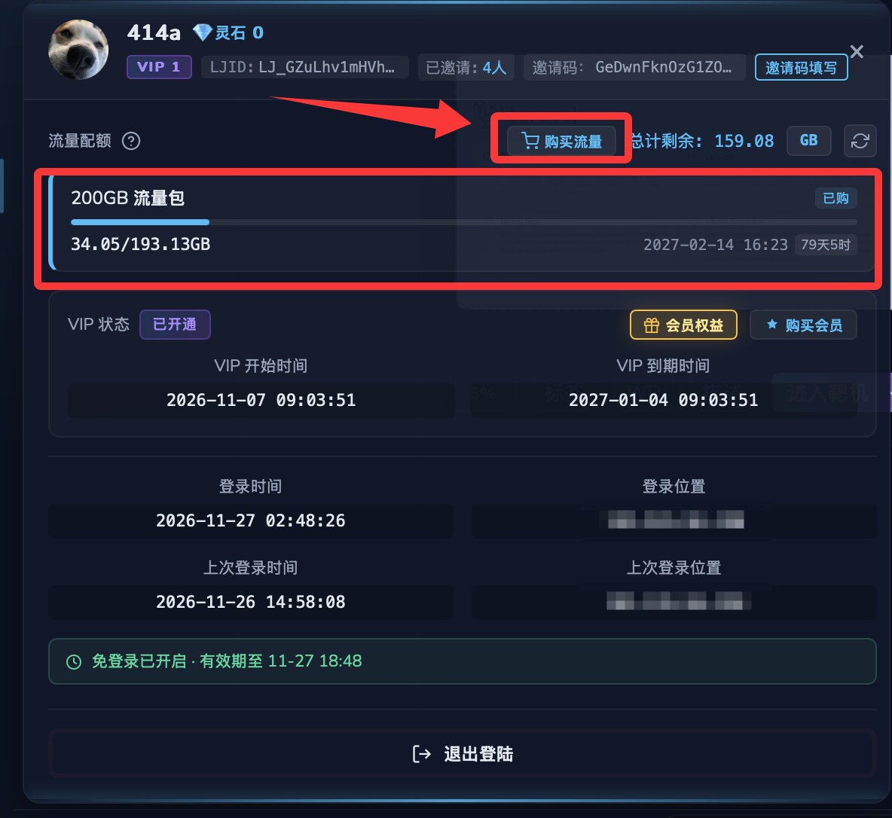

**界面说明**（数字与下图标注对应）

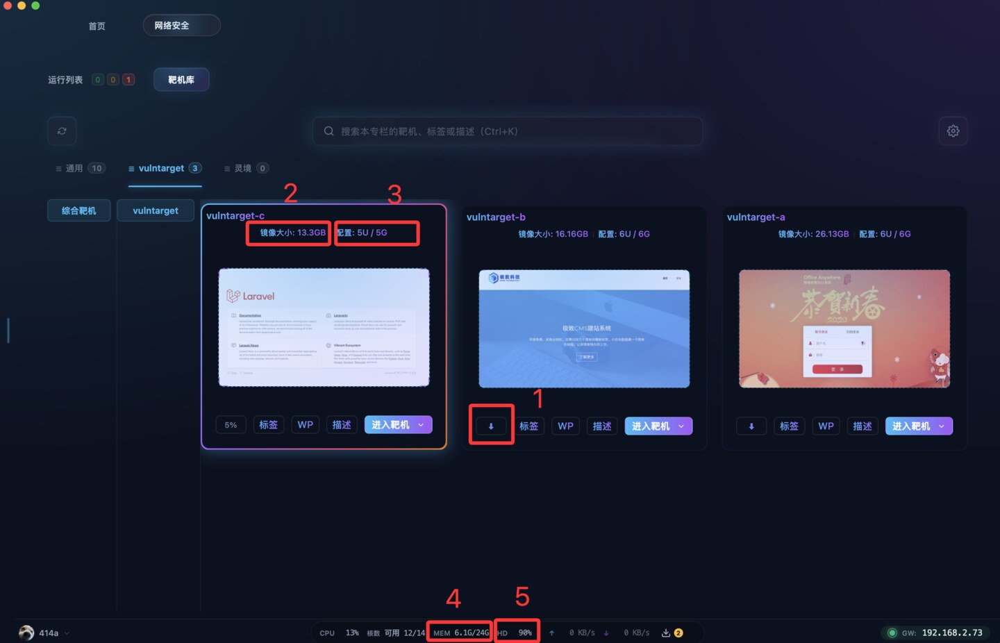

1. **下载按钮**：点击后开始下载靶机镜像。
2. **镜像大小**：靶机镜像的体积，即下载所需流量。
3. **配置**：靶机启动所需的 CPU 核心数与内存。
4. **宿主机内存**：本机（电脑）的内存占用信息。
5. **宿主机硬盘**：本机（电脑）的硬盘占用信息。

**下载前提：先启动灵境路由**

下载靶机前需先启动**灵境路由**，待路由指示灯变为**绿色**后再开始下载。若路由未启动或状态异常，下载会直接失败。

**常见报错**：下载队列中显示「失败」，并提示「服务端未返回可下载资源」。此时请先检查灵境路由的运行状态，确认指示灯为绿色后重新下载。

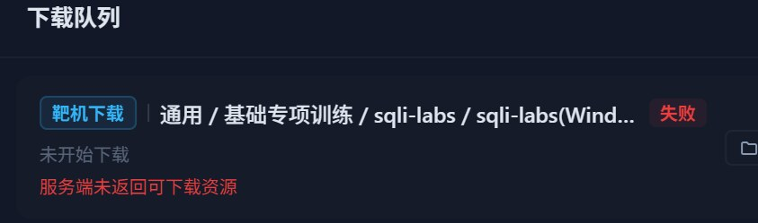

#### 4.1.5 启动靶机

**第一步：进入靶机详情**

在「靶机库」中找到目标靶机，点击卡片下方的**进入靶机**按钮。

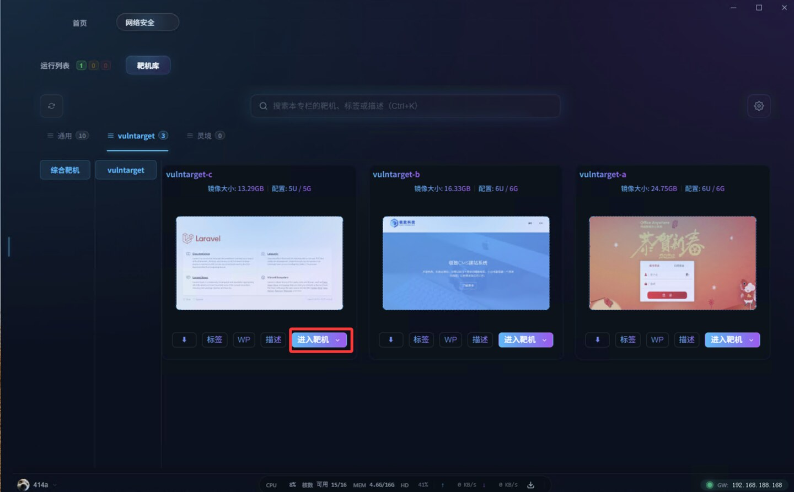

**第二步：启动所有靶机**

点击**启动所有靶机**开始启动。同一菜单中还提供 暂停靶机 / 继续靶机 / 停止靶机 / 保存快照 / 恢复快照 等操作；启动过程中面板显示「等待靶机启动…」。

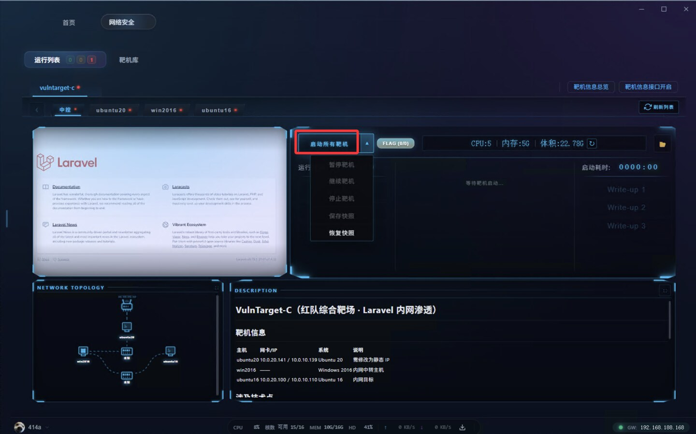

**第三步：确认启动成功**

启动完成后，右侧面板会显示靶机 IP 地址、运行时间与启动耗时，靶机状态指示灯（呼吸灯）变为**绿色**；下方 NETWORK TOPOLOGY 区域展示靶机网络拓扑。

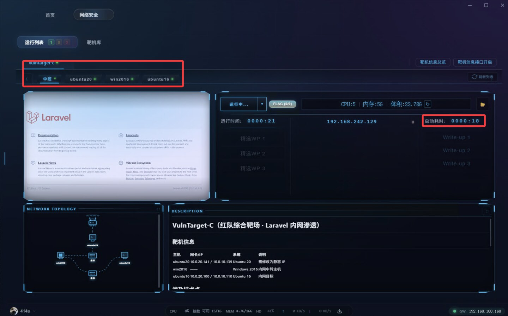

点击拓扑图右上角的放大按钮，可查看完整的网络拓扑视图。

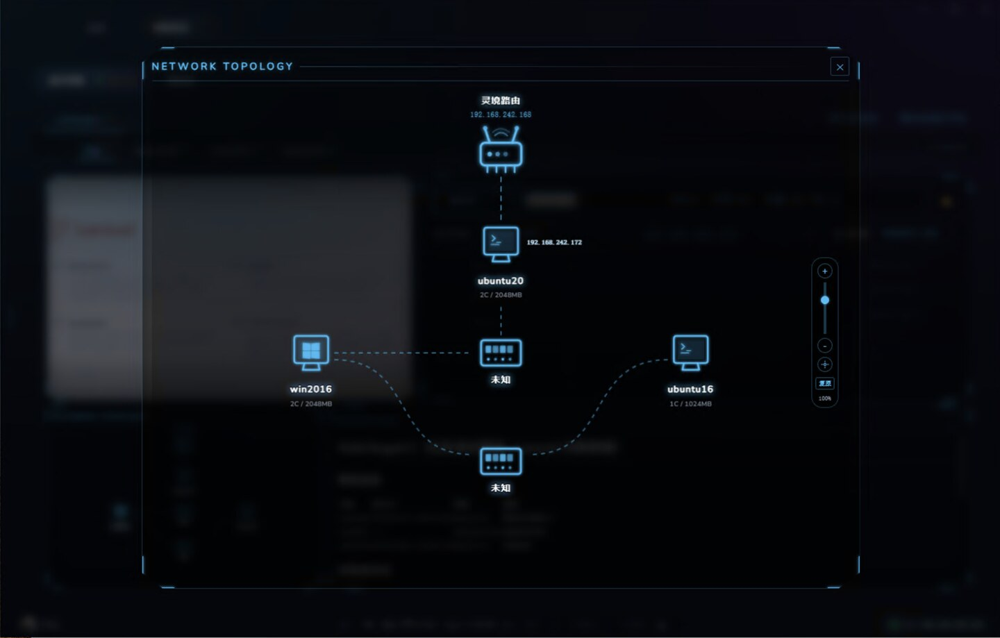

**第四步：获取靶机账号密码**

点击右上角「靶机信息」按钮，可查看靶机的账户与密码，并支持一键复制。

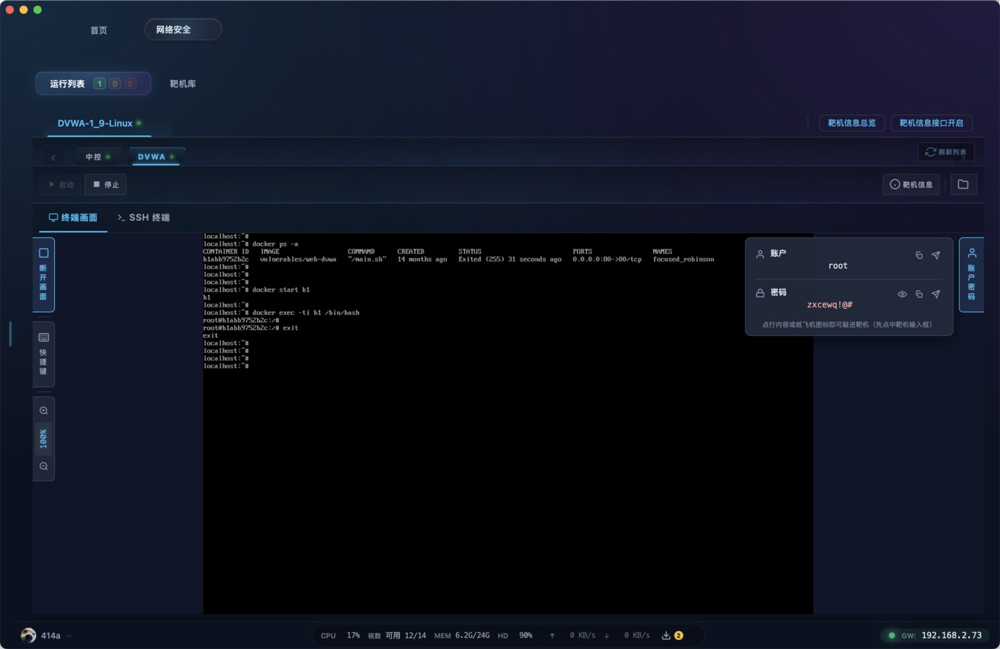

#### 4.1.6 子靶机控制

提供三种方式操控子靶机：

| 方式 | 入口 | 说明 |
| --- | --- | --- |
| 终端画面 | 「终端画面」标签 | 在图形化画面中直接操控子靶机 |
| SSH 终端 | 「SSH 终端」标签 | 通过 SSH 登录子靶机执行命令 |
| 内置 SFTP | SSH 终端右上角的「SFTP」 | 可视化浏览子靶机文件，拖拽上传、点击下载 |

**终端画面**：直接在画面中操控子靶机。

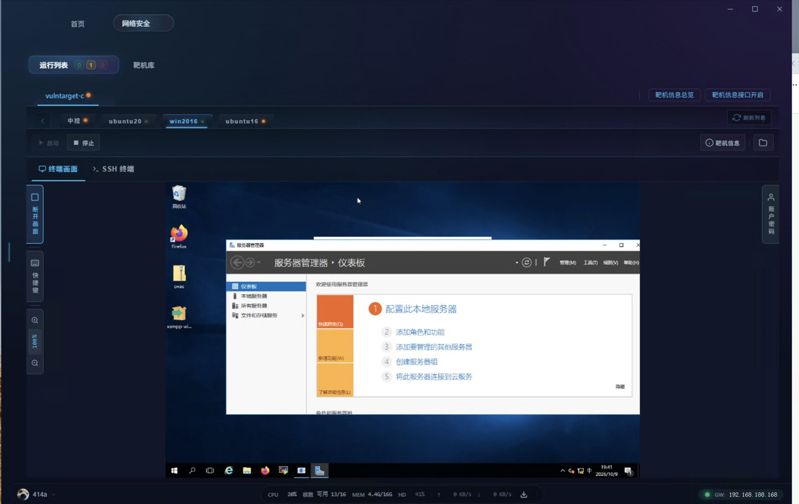

**SSH 终端**：以命令行方式登录子靶机。

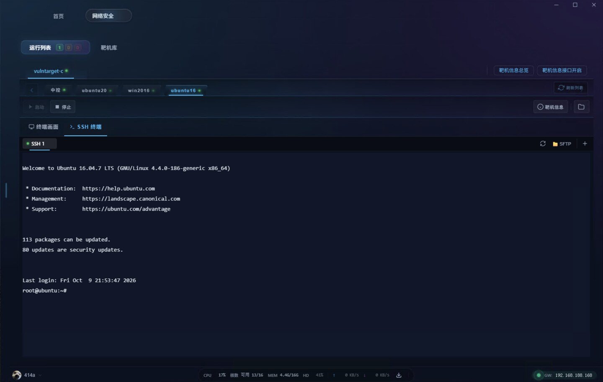

**内置 SFTP**：

- 将文件拖拽到上方区域即可上传；
- 点击右上角下载图标即可下载文件；
- 文件列表展示名称、大小、修改时间与权限。

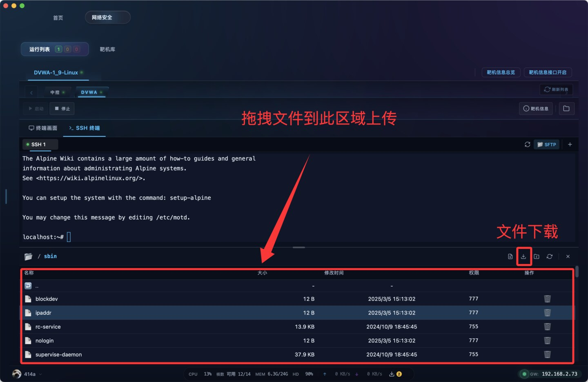

#### 4.1.7 局域网设备访问靶机

Windows 与 macOS 物理机均已支持**局域网内的其他设备访问靶机**（该能力属于会员权益）。

**前置条件**

- 已开通会员（局域网访问为会员权益）；
- 灵境路由已启动，指示灯为绿色；
- 靶机已启动，并已获取到 IP 地址。

**第一步：打开「局域网」面板**

在路由控制台中点击**局域网**开关，打开「局域网 LAN」面板。

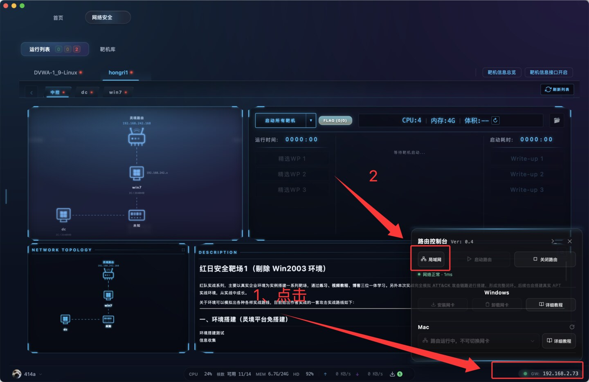

**第二步：开启局域网访问**

点击面板中的**开启局域网访问**。切换后路由会自动重启，请等待路由恢复。

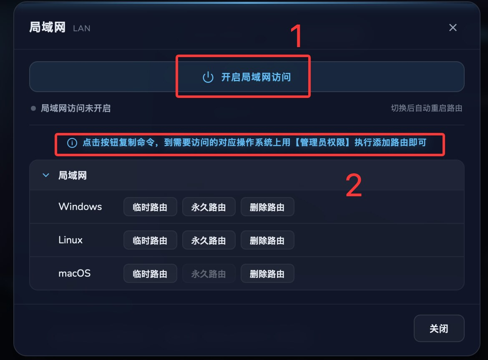

**第三步：复制对应系统的路由命令**

面板下方按操作系统列出了添加路由的命令。根据**访问端设备**的系统选择 Windows / Linux / macOS，再点击**临时路由**或**永久路由**复制命令。

- **临时路由**：设备重启后失效，适合临时联调；
- **永久路由**：重启后仍然生效，适合固定环境；
- macOS 的「永久路由」暂不可用（按钮为灰色），如需持久访问可选择临时路由或其他方式。

**第四步：在访问端以管理员权限执行**

把复制的命令粘贴到**需要访问靶机的那台设备**上执行，且必须使用管理员权限：

- **Windows**：以管理员身份运行 PowerShell 或命令提示符；
- **Linux / macOS**：在命令前加 `sudo` 执行。

**第五步：确认访问入口**

局域网访问开启后，主界面右下角会显示本机的局域网地址（形如 `GW: 192.168.242.73`）。局域网内的其他设备即可通过该地址访问靶机。

**访问不通时**

1. 确认命令是在**访问端设备**上执行的，且具备管理员权限、执行过程无报错；
2. 确认访问端与本机处于同一局域网，且能连通界面右下角显示的 GW 地址；
3. 仅临时使用时建议选择「临时路由」，用完点击**删除路由**清理，或在面板中关闭局域网访问。

### 4.2 邀请机制

**第一步：复制邀请码**

在个人中心**单击邀请码**即可复制，界面顶部会提示「已复制邀请码」。

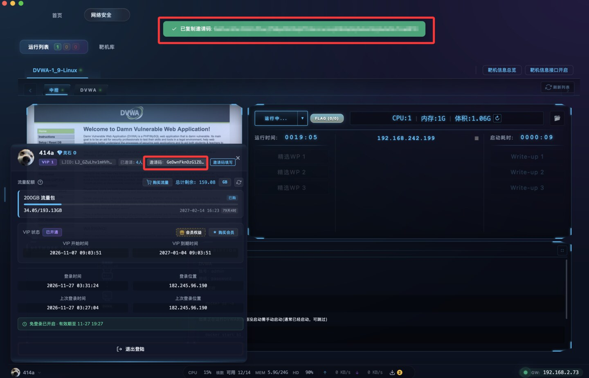

**第二步：填写邀请码**

点击「邀请码填写」，输入他人分享给你的邀请码后提交。填写成功后，**邀请人与被邀请人均可获得 7 天会员**；每人最多可邀请 10 人，超过 10 人后不再增加会员时长；每个账号只能填写一次邀请码。

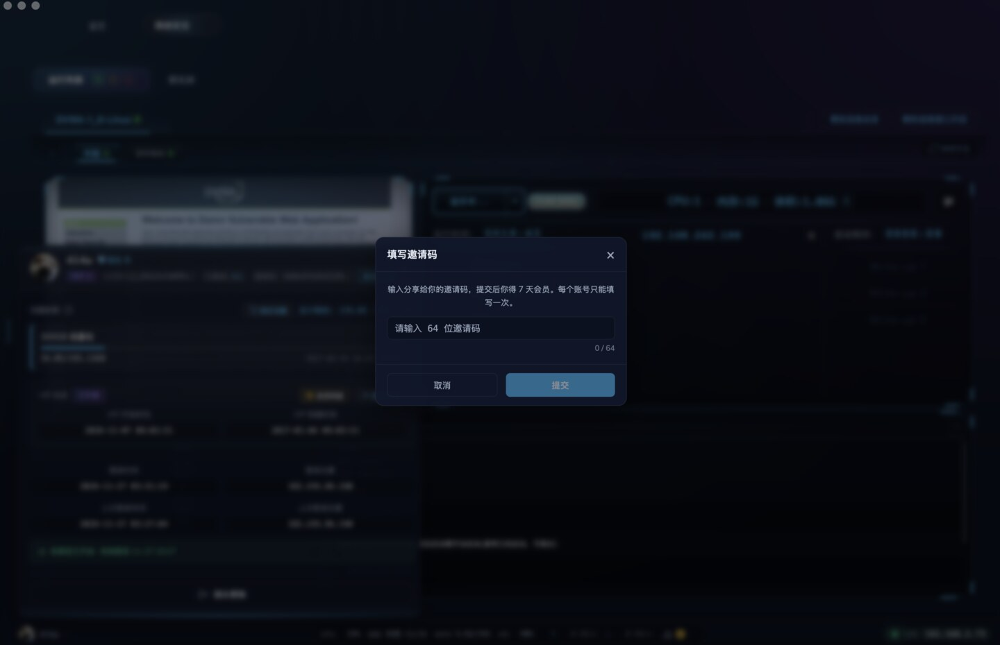

## 五、平台权限说明

旧版灵境平台需要全局管理员权限；LingJing V2 不再采用全局授权方式——管理员权限**仅作用于路由启动与进程清理**，平台本身以普通用户权限运行。

### 关于未签名应用的安装拦截

由于软件尚未进行数字签名，在 macOS 与 Windows 上可能出现安装被拦截，甚至被安全软件误判清除的情况。

**macOS**

系统会对从网络下载的未签名应用进行安全拦截。此时文件本身并未损坏，只需通过命令解除隔离标记即可正常打开：

```bash
sudo xattr -rd com.apple.quarantine /Applications/LingJing.app
```

**Windows**

程序尚未进行**数字签名**，系统自带的 Defender 或第三方杀毒软件可能拦截，甚至直接删除 `LingJing.exe`。遇到这种情况，请先将解压目录加入杀毒软件的**信任列表 / 白名单**，再从隔离区恢复文件，继续完成安装。

## 六、常见问题

| 问题现象                                  | 原因               | 处理方式                                                                     |
| ------------------------------------- | ---------------- | ------------------------------------------------------------------------ |
| 下载队列显示「失败」，提示「服务端未返回可下载资源」            | 灵境路由未启动或状态异常     | 启动灵境路由，确认指示灯为绿色后重新下载                                                     |
| 靶机库列表为空                               | 列表未被拉取           | 点击搜索框左侧的刷新按钮重新拉取                                                         |
| 下载流量扣除异常                              | 停止或中断下载后，流量回退未完成 | 通过微信服务号「深灵奇境科技」反馈，详见「问题反馈与联系」                                            |
| macOS 提示应用「已损坏」或无法打开                  | 未签名应用被系统隔离       | 执行 `sudo xattr -rd com.apple.quarantine /Applications/LingJing.app` 解除隔离 |
| Windows 上安装被拦截，或 `LingJing.exe` 被杀软删除 | 程序未做数字签名         | 将解压目录加入杀毒软件信任列表，再从隔离区恢复文件                                                |
| 不确定是否要先买会员才能打靶                        | 对流量包与会员的定位存在误解   | 仅购买流量包即可完成基础打靶，会员只用于高级功能                                                 |

## 七、问题反馈与联系

使用过程中如遇到**流量扣除异常、平台 BUG、平台漏洞**等问题，请通过**微信服务号「深灵奇境科技」**联系我们。

| 反馈类型 | 典型场景 |
| --- | --- |
| 流量扣除异常 | 扣费流量与实际下载量不符；下载停止或中断后，未下载流量未回退；流量包余量与实际不符 |
| 平台 BUG | 界面显示异常、按钮无响应、靶机启动 / 停止失败、终端与 SFTP 无法连接等 |
| 平台漏洞 | 安全相关问题、权限越界、数据异常等需要官方确认的问题 |

**为便于快速定位问题，反馈时请尽量附上：**

- 账号信息（LJID）
- 问题发生的时间与所在页面
- 截图或录屏
- 涉及的靶机名称，以及对应的下载 / 启动记录

收到反馈后我们会尽快核实处理。


